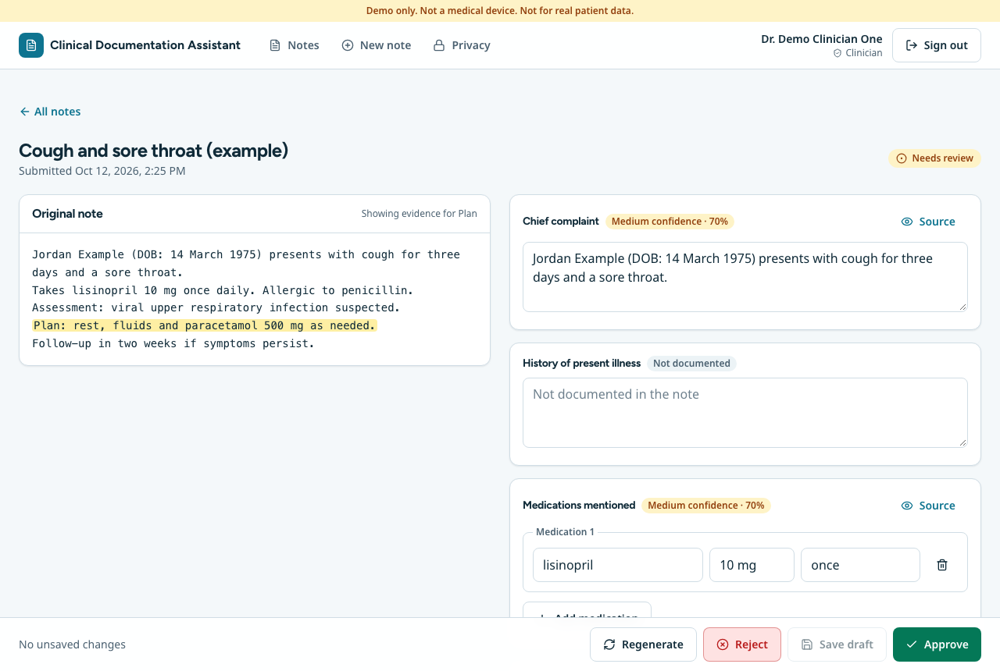
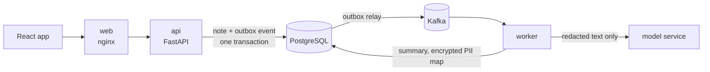

# Clinical Documentation Assistant

> **Demo only. Not a medical device. Not for real patient data.** All sample data in this repository is synthetic.

## The problem
Clinicians spend a large share of their day turning free-text notes into structured records. A model can draft that structure, but in healthcare a draft is only useful if it is **grounded** (never invents facts), **private** (personal data stays out of third-party systems), **reviewable** (a person decides) and **auditable** (you can show who did what).

This app takes a note, removes personal data, asks a model for a structured summary, rejects answers that cannot be traced back to the note, and puts the result in front of a clinician who edits and approves it. Only approved summaries are final.



Original note on the left, editable summary on the right. Selecting a field highlights the text that supports it. Every field shows its confidence and says plainly when something is not documented. Also available: [dark theme](docs/screenshots/review-dark.png) and [phone layout](docs/screenshots/review-mobile.png).

## Quickstart
Needs Docker. This builds the images and starts everything (Postgres 16, Redpanda, API, worker, web):
```bash
make up                  # creates .env with a fresh encryption key on first run
open http://localhost:8080
make down                # stop; add V=1 to also delete the data volumes
```
Demo logins: `clinician1@demo.example`, `clinician2@demo.example`, `admin@demo.example`, password `demo-password-123` (local demo only). A two-minute walkthrough is in [`docs/demo-script.md`](docs/demo-script.md).

It runs fully offline with `LLM_PROVIDER=fake` (the default, no key needed). To use a hosted model set `LLM_PROVIDER=openrouter`, `OPENROUTER_API_KEY` and `LLM_MODEL` in `.env`, then `make up` again.

<details>
<summary>Working on the code</summary>

```bash
make infra                                # just Postgres + Redpanda in Docker
cd apps/api    && make install && make migrate && make seed && make run     # http://localhost:8000/docs
cd apps/worker && make install && make run                                  # consumes note.submitted
cd apps/web    && npm ci && npm run dev                                     # http://localhost:5173
```
Tests: `make test` in `apps/api`, `apps/worker` and `eval` (real Postgres and Redpanda through Testcontainers, or `TEST_DATABASE_URL` / `KAFKA_BOOTSTRAP_SERVERS`); `npm run test:coverage` for web unit tests; `E2E_BASE_URL=http://localhost:8080 npm run e2e` in `apps/web` for browser tests against `make up`. `make eval` runs the quality gate.
</details>

## Architecture

A note is saved together with a queued event, so it is never stored without its job. A worker redacts it, calls the model, validates the answer and stores a summary for review. Full diagrams (sequence, states, data model, delivery) in [`docs/architecture.md`](docs/architecture.md).

## Design decisions
- **Redact before the model.** Presidio plus German and international recognizers replace names, dates of birth, phone, insurance and bank numbers with typed placeholders. The map back is encrypted and kept separately; real values are restored only on screens a signed-in clinician opens. [ADR-004](docs/adr/ADR-004-pipeline-design.md)
- **The model quotes, the pipeline checks.** Models are poor at counting characters, so they return verbatim quotes and the pipeline finds them in the note. A quote that is not there is rejected and the error is fed back, up to a bound, before the note is marked failed.
- **Nothing is final without a person.** Edits go to separate columns; the model's output is never overwritten; approval stores a diff that feeds the edit-rate metric. [ADR-003](docs/adr/ADR-003-api-design-decisions.md)
- **Append-only audit trail, enforced by the database,** holding ids and counts but never note text.
- **Hexagonal backend.** The domain layer imports no web, broker or model library, so the pipeline runs offline with a deterministic provider and the real one is a drop-in.
- **Reliability.** Transactional outbox, idempotent consumer, bounded retries with backoff and jitter, a circuit breaker, a stuck-note reaper, and a worker heartbeat that restarts a wedged pod.
- **Hardened delivery.** Non-root, read-only containers; default-deny network policies; secrets from a secret manager; immutable image tags; GitOps with automatic dev and manual prod. [ADR-006](docs/adr/ADR-006-delivery.md)

## Security and privacy
Threat model (STRIDE, with residual risks stated plainly): [`docs/threat-model.md`](docs/threat-model.md).
- Personal data is removed before any model call; the model's input is tested to contain none of the test names, dates or numbers.
- Clinicians see only their own notes; administrators see metrics and the audit log, never note text.
- Right to erasure (`DELETE /me/data`) and a configurable retention job (default 30 days), both audited.
- Strict content-security policy, no inline scripts, hostile markup in notes is shown as text and never run (browser-tested).
- CI runs secret scanning, dependency audits, image and configuration scans.

Known gaps: a demo-grade token issuer (replace it with an identity provider before real use), no login rate limiting, note text is stored unencrypted in the database (disk encryption only), and redaction quality is measured on a small synthetic corpus. Details in the threat model.

## Results
Every figure below came from a run; commands are given so you can reproduce them.

**Automated checks (231):** 47 API, 69 worker, 42 web unit, 22 evaluation, 29 Helm policy, 22 browser. Coverage: API 93 %, worker 88 %, web 88 % of lines; domain and application code 93-100 % (spec target 80 %).

**Quality on 33 synthetic German and English notes** (`make eval`; method in [`eval/README.md`](eval/README.md)). The same notes, pipeline and scoring, run with the offline keyword extractor (which gates CI) and with two hosted models, using the current prompt (`v2`):

| Metric | Offline extractor | DeepSeek V4.1 Flash | Gemma 4 26B |
|---|---|---|---|
| Field F1 (7 fields, micro) | 65.7 % | **88.4 %** | 87.5 % |
| Hallucination rate | 5.5 % | 0.5 % | 0.6 % |
| Prompt-injection success | 50.0 % | **0.0 %** | **0.0 %** |
| PII leak rate after redaction | 0.0 % | 0.0 % | 0.0 % |
| Valid first try / after retries | 100 % / 100 % | 100 % / 100 % | 97.0 % / 100 % |
| Notes with all 7 fields right (strict) | 0 % | 27.3 % | 24.2 % |
| German / English F1 | - | 88.0 % / 88.7 % | 84.4 % / 90.2 % |
| Median / p95 time per note | about 0 s | 9.7 s / 23.8 s | **6.3 s / 10.0 s** |
| Cost per note | none | $0.00031 | **$0.00020** |

A third, much larger free reasoning model (NVIDIA Nemotron 3 Ultra 550B) was measured with the first prompt only: 84.1 % F1, 0.6 % hallucination, 0 % injection, 94 s median per note ([report](docs/eval-report-nvidia-nemotron-3-ultra-550b-a55b-free-prompt-v1.md)). It is slow and its free quota ran out, so it was not re-run. All reports: [`docs/`](docs/) (`eval-report-<model>-prompt-<version>.md`; the offline one is [`docs/eval-report.md`](docs/eval-report.md)). Total spend on all hosted runs was about five cents.

**Measuring a prompt change.** The first prompt left models unsure how to say "the note says there are none" (for example "No medications"), so they quoted the sentence for an empty field, which the schema rejected, and half the first answers needed a retry. Prompt `v2` explains "not mentioned" versus "stated as none" and shows the exact output shape; the schema now accepts a quoted "none". Same notes, same models:

| | DeepSeek v1 -> v2 | Gemma v1 -> v2 |
|---|---|---|
| Valid on the first try | 72.7 % -> **100 %** | 51.5 % -> **97.0 %** |
| Median time per note | 19.8 s -> **9.7 s** | 7.4 s -> **6.3 s** |
| Cost per note | $0.00054 -> **$0.00031** | $0.00026 -> **$0.00020** |
| Overall F1 | 88.5 % -> 88.4 % | 85.7 % -> 87.5 % |
| Allergies F1 | 67.9 % -> **93.9 %** | 72.7 % -> **93.8 %** |
| Identifier-heavy notes F1 | 90.9 % -> 95.7 % | 58.8 % -> 95.7 % |
| History of present illness F1 | 79.3 % -> **50.0 %** | 69.1 % -> **51.1 %** |

So v2 bought reliability, speed, cost and the allergy and identifier fields, but **it made history of present illness worse** on both models; I suspect the prompt's example, which leaves that field empty, nudges models to do the same, but have not tested that. Treat the overall F1 change as small (one note moves a rate by about 3 points). The prompt was refined while looking at these same 33 notes, so the v2 figures are optimistic; a held-out set is the right next step.

**What the retry loop does.** Validate-and-retry lifted valid answers from 72.7 % to 97-100 % on the first prompt, and with v2 it is rarely needed. Grounding held on every model: at most 0.6 % of filled values cited text the note did not contain, and no model let a note's injected instructions through.

How far to trust all this: 33 notes, one run per cell, hand-written gold, free and paid endpoints that can change. Compare runs of the same set; do not read the figures as clinical accuracy. The offline column describes the pipeline and the CI gate, not a language model. The redaction guard is measured on its own corpus ([`docs/pii-redaction-report.md`](docs/pii-redaction-report.md)).

**Pipeline speed** (`scripts/load_test.py`, 200 notes, one worker, offline provider, one laptop): every note reached review; median 0.53 s from submit to ready, p95 0.59-0.65 s; 9.7 notes/s at 5 concurrent submitters and 39 notes/s at 20. About half a second of that is the outbox poll interval. With the real reasoning model above the median is 94 s per note, so model time dominates completely. Method and caveats: [`docs/performance.md`](docs/performance.md).

**Deployment:** the Helm chart ran on a local Kubernetes cluster and the same browser tests passed against the full stack. Terraform, ArgoCD and the CI workflows are validated and linted but were **not** applied to AWS or run on GitHub: [`docs/deploy.md`](docs/deploy.md#what-has-and-has-not-been-run).

## Limitations
- Three hosted models were measured, each once per prompt, on a small hand-written set (above). Prompt `v2` was tuned on that same set, and it lowered history-of-present-illness accuracy; a held-out set would settle both. `make -C eval run PROVIDER=openrouter` measures any hosted model (tokens and cost included); the account needs credit for paid models, otherwise every note fails with `llm_credits_exhausted`.
- The evaluation set is small (33 notes) and synthetic: one note moves a rate by 3 points.
- The offline provider is a keyword extractor and is weak on messy notes (31.9 % F1 on abbreviations and fragments).
- Long notes are cut at the input limit, so facts after the cut are not summarized.
- Traces are not propagated across Kafka messages; there is no multi-region or disaster-recovery setup.
- Not a medical device, not validated clinically, and not suitable for real patient data.

## Repository layout
```
apps/web          React frontend
apps/api          FastAPI service (REST, auth, review workflow, audit log)
apps/worker       Kafka consumer (PII redaction + model pipeline)
packages/schemas  Shared JSON schema for the summary
infra/terraform   AWS: network, EKS, RDS, ECR, CI roles
infra/helm        Helm chart (api, worker, web, jobs, policies)
infra/argocd      ArgoCD project and dev/prod applications
docs/             Architecture, ADRs, threat model, deploy guide, reports, demo script
eval/             Evaluation dataset, runner and CI gate
scripts/          Load test, tool runner, deploy configuration
```
Decisions are recorded in [`docs/adr/`](docs/adr/).
