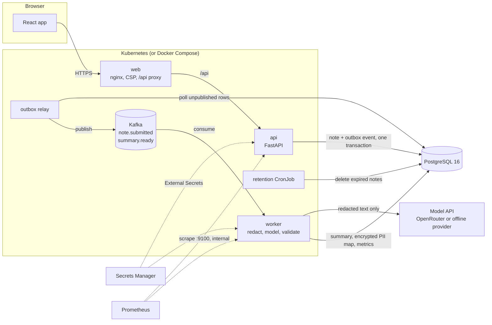
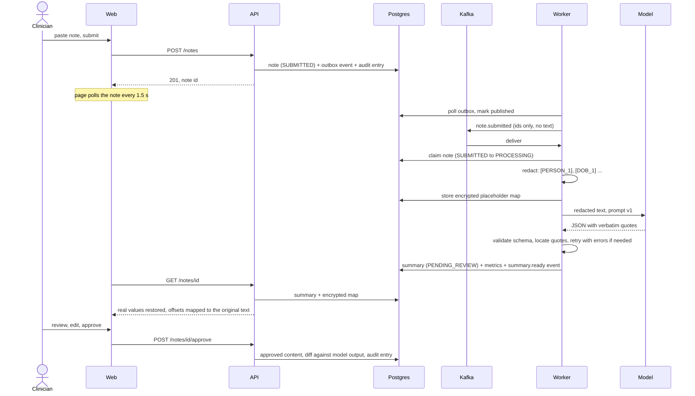
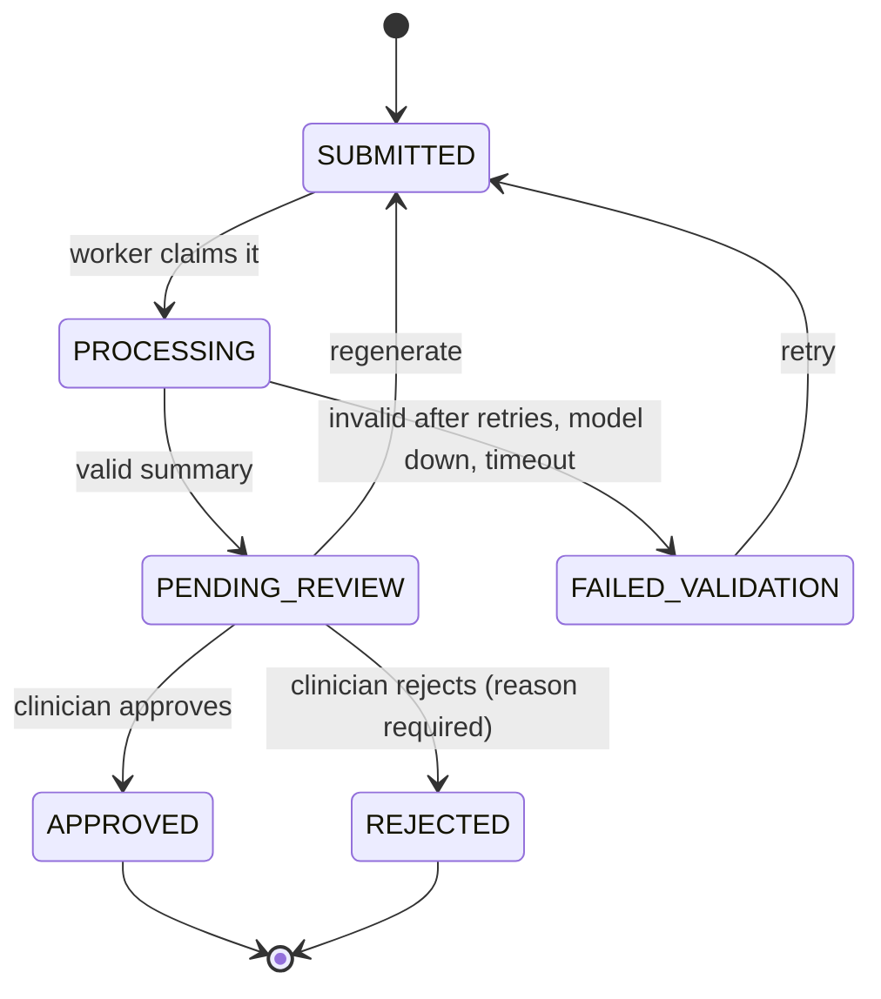
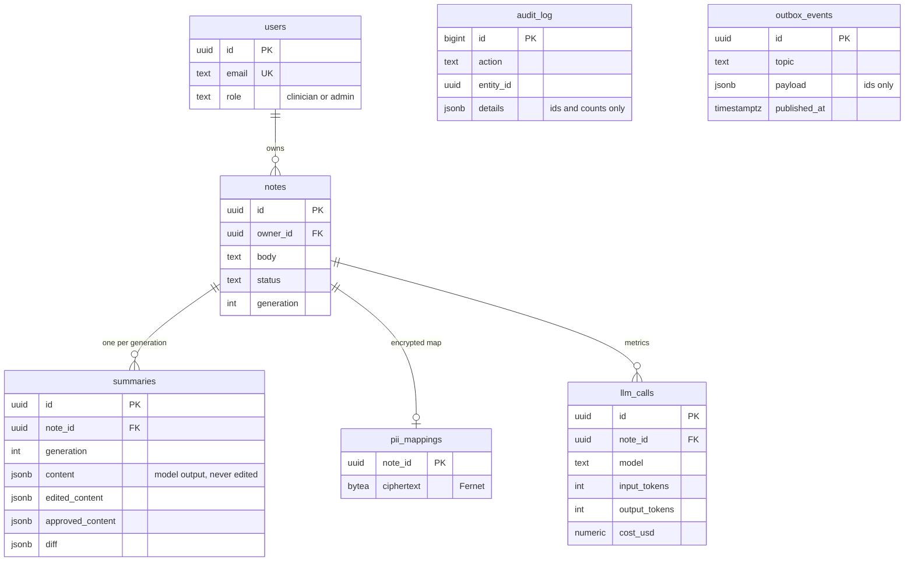
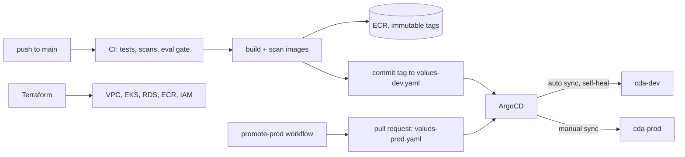

# Architecture

Demo only. Not a medical device. Not for real patient data.

## System overview
A clinician submits a note. The API stores it and queues work; a worker removes personal data, asks a model for a structured summary, checks the answer, and stores it for the clinician to review. Nothing is final until a person approves it.

The relay runs inside the worker process. Metrics are on a separate internal port, so the public path never reaches them.

## What happens to one note

## Note states

Invalid moves are refused by one function (`domain/state_machine.py`) and the API answers 409.

## Data model

`audit_log` has no foreign keys and is append-only (database triggers reject update, delete and truncate), so erasing a user's notes never touches the audit trail. `outbox_events` is the transactional outbox.

## Delivery

Details: [`deploy.md`](deploy.md) and [`adr/ADR-006-delivery.md`](adr/ADR-006-delivery.md).

## Layers
`apps/api/src/cda_api` is split ports-and-adapters style. `domain/` holds the state machine, summary schema, diff and redaction map and imports no web, broker or model library. `application/` holds the use cases. `adapters/` holds Postgres, crypto and token code. `api/` holds the HTTP layer. The worker follows the same shape: `domain/` (ports, prompts, validation loop) and `adapters/` (Presidio, providers, Kafka).

Related decisions: [ADR-001](adr/ADR-001-tech-stack.md) stack, [ADR-002](adr/ADR-002-auth-and-cloud-target.md) auth and cloud, [ADR-003](adr/ADR-003-api-design-decisions.md) API, [ADR-004](adr/ADR-004-pipeline-design.md) pipeline, [ADR-005](adr/ADR-005-frontend-design.md) frontend, [ADR-006](adr/ADR-006-delivery.md) delivery.
